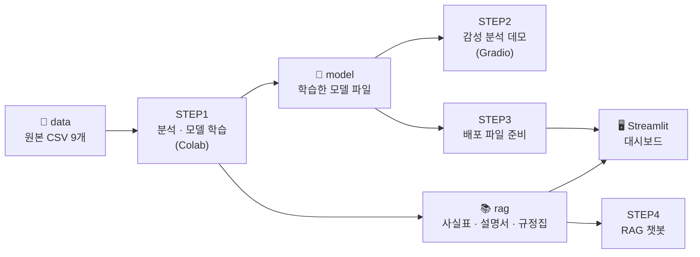
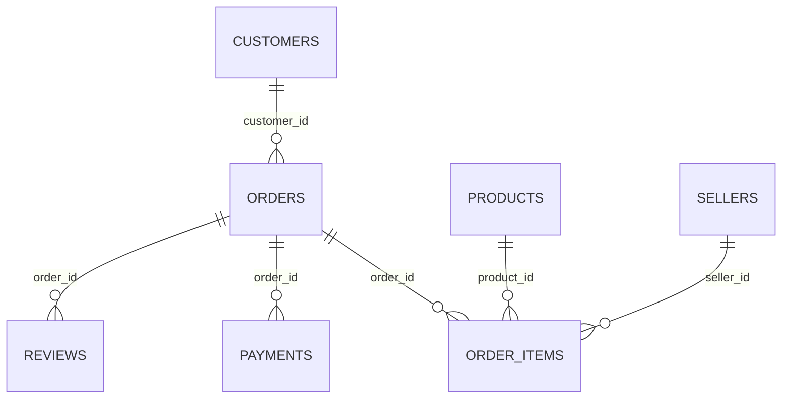
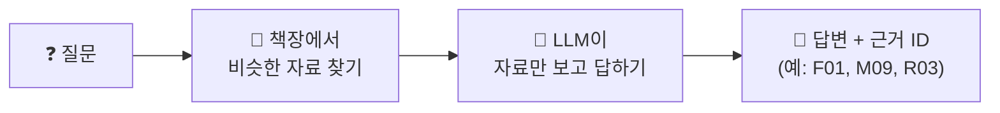

# 📦 Olist 이커머스 데이터 분석 실습

브라질 온라인 쇼핑몰 **Olist**의 실제 주문 데이터(2016~2018, 주문 약 10만 건)로
**데이터 분석 → AI 모델 학습 → 모델 써 보기 → 웹 대시보드 배포**까지 한 번에 경험하는 실습 자료입니다.

> 코딩을 처음 해도 괜찮습니다. 노트북을 위에서부터 순서대로 실행하면 됩니다.

---

## 🗺️ 전체 흐름 한눈에 보기



| 단계 | 하는 일 | 실행 환경 | 결과물 |
|---|---|---|---|
| **STEP1** 모델 학습 | 데이터 이해 · EDA · AI 모델 4종 학습 | Google Colab | `model/` 폴더의 모델 파일 |
| **STEP2** 모델 써 보기 | 문장을 넣으면 긍정/부정이 나오는 화면 | Google Colab | Gradio 데모 화면 |
| **STEP3** 배포 준비 | 대시보드에 필요한 데이터·모델을 zip으로 모으기 | Google Colab | 배포용 파일 묶음 |
| **STEP4** RAG 챗봇 | 분석 결과를 찾아서 근거와 함께 답하는 챗봇 | Google Colab | 3가지 채널 챗봇 |
| **대시보드** | 분석 + 모델 + 챗봇을 웹페이지 하나로 | 내 컴퓨터 | Streamlit 웹앱 |

---

## 📁 폴더 구조

```
Olist-Data-Analysis/
├─ data/                       ← 원본 CSV 9개 + 통합 데이터 + 판매자 표
├─ model/                      ← STEP1에서 학습한 모델 파일
├─ rag/                        ← 챗봇이 찾아볼 자료 (사실표 · 모델 설명서 · 규정집 PDF)
├─ STEP1_Model_Training/       ← 분석 · 모델 학습 노트북 (01 ~ 10)
├─ STEP2_Model_Serving/        ← Gradio 감성 분석 데모
├─ STEP3_Local_Deploy/         ← 배포용 파일 준비 노트북
├─ STEP4_RAG_Chatbot/          ← RAG 챗봇 노트북
└─ stremlit_olist_dashboard/   ← Streamlit 대시보드 (바로 실행 가능)
```

---

## 📊 데이터 소개 (`data/`)

Olist 데이터는 **표 8~9개가 ID로 연결된 구조**입니다. 주문 1건에 상품이 여러 개 들어갈 수 있어서(1:N) 합치면 행이 늘어납니다.



| 파일 | 내용 |
|---|---|
| `olist_orders_dataset.csv` | 주문 (주문 시각, 배송 예정일·완료일, 상태) |
| `olist_order_items_dataset.csv` | 주문에 담긴 상품 · 가격 · 배송비 · 판매자 |
| `olist_customers_dataset.csv` | 고객 (도시 · 주) |
| `olist_products_dataset.csv` | 상품 (카테고리 · 무게 · 크기 · 사진 수) |
| `olist_sellers_dataset.csv` | 판매자 (도시 · 주) |
| `olist_order_payments_dataset.csv` | 결제 수단 · 할부 · 금액 |
| `olist_order_reviews_dataset.csv` | 리뷰 별점 · 리뷰 글(포르투갈어) |
| `olist_geolocation_dataset.csv` | 우편번호별 위도 · 경도 |
| `product_category_name_translation.csv` | 카테고리 이름 (포르투갈어 → 영어) |
| `olist_master_data.csv` | ⭐ 위 표들을 하나로 합친 통합 데이터 (04 노트북 결과, 119,143행) |
| `seller_table.csv` | 판매자별 요약 표 (10 노트북 결과, 이탈 예측용) |

---

## 📘 STEP1. 분석 · 모델 학습 (`STEP1_Model_Training/`)

### ① 데이터 준비와 분석 (01 ~ 05)

| 노트북 | 주제 | 핵심 질문 |
|---|---|---|
| `01_olist_intro` | Olist 소개 (코드 없음) | 어떤 쇼핑몰의 어떤 데이터일까? |
| `02_data_loading` | 데이터 내려받기 (KaggleHub → Google Drive) | 실습 데이터를 어디에, 어떻게 준비할까? |
| `03_data_understanding` | 표 구조 · 결측치 · 연결 관계 | 각 표에는 무엇이 있고 어떻게 연결될까? |
| `04_data_merge` | 표 합치기 (merge) | 흩어진 표를 어떻게 하나로 합칠까? |
| `05_eda` | 탐색적 분석 · 인사이트 10가지 | 데이터에서 어떤 비즈니스 패턴이 보일까? |

**05 EDA에서 찾은 인사이트 (일부)**
- 고객 약 97%가 **한 번만 사고 떠난다**
- 성장은 객단가가 아니라 **주문 수**에서 왔다
- **배송이 늦으면 리뷰 점수가 무너진다**
- 성수기와 먼 지역에서 배송이 늦어진다

### ② AI 모델 만들기 (06 ~ 10)

| 노트북 | 주제 | 방법 | 핵심 결과 | 저장 파일 |
|---|---|---|---|---|
| `06_recommendation` | 비슷한 상품 추천 | 규칙 기반 vs **KNN** | 기준 상품과의 차이: 랜덤 72% → 가격 조건 45% → **KNN 30%** | `part6_recommend.pkl` |
| `07_1_sentiment_ml` | 리뷰 감성 분석 ① | **TF-IDF + 로지스틱 회귀** | 정확도 **0.917** | `part7_1_sentiment_ml.pkl` |
| `07_2_sentiment_dl` | 리뷰 감성 분석 ② | 딥러닝 (Embedding · Bi-LSTM) | 정확도 0.92 내외 → 머신러닝과 **거의 같음** | `part7_2_sentiment_model.keras` · `part7_2_tokenizer.pkl` |
| `07_3_sentiment_bert` | 리뷰 감성 분석 ③ | 사전학습 BERT (Hugging Face) | 추가 학습 없이 0.730 → 비교용 | 저장 안 함 |
| `08_seller_segment` | 판매자 유형 나누기 | **K-Means** (비지도 학습) | 핵심 우량 · 신규 성장 · 휴면 · 저평점 위험 4유형 | `part8_seller_segment.pkl` |
| `09_seller_churn` | 판매자 이탈 예측 | 로지스틱 회귀 vs 랜덤 포레스트 | 로지스틱 회귀 F1 0.58 (규칙 0.53보다 높음) | `part9_seller_churn.pkl` |
| `10_business_strategy` | 분석 → 실행 전략 | 저장한 모델을 최신 데이터에 적용 | 연락할 판매자 순위 · 별점과 내용이 다른 리뷰 | `seller_table.csv` |

> 💡 **복잡한 모델이 항상 이기는 것은 아닙니다.** 감성 분석에서는 가장 가볍고 단순한 머신러닝 모델(07_1)이 딥러닝·BERT만큼, 또는 더 잘 맞아서 이 모델을 웹앱에 씁니다.

---

## 🎛️ STEP2. 모델 써 보기 (`STEP2_Model_Serving/`)

`01_sentiment_demo_gradio.ipynb` — STEP1에서 저장한 감성 모델 2개(머신러닝 · 딥러닝)를 불러와, **문장을 넣으면 바로 긍정/부정 확률이 나오는 화면**을 만듭니다.

```
리뷰 문장 입력  →  모델 2개가 각각 판정  →  긍정 / 부정 확률 표시
```

- 포르투갈어로 학습한 모델이라 한국어 · 영어 문장은 결과가 엉뚱하게 나옵니다.
- Colab 런타임이 켜져 있는 동안만 열립니다. 계속 열어 두려면 STEP3의 웹앱을 씁니다.

---

## 🚀 STEP3. 배포 준비 (`STEP3_Local_Deploy/`)

`00_prepare_deploy_files.ipynb` — 대시보드 실행에 필요한 **데이터 · 모델 · 설치 목록**을 한 폴더에 모아 zip 하나로 내려받습니다.

| 만드는 파일 | 내용 |
|---|---|
| `data/orders.parquet` · `data/items.parquet` | 대시보드용 주문 · 상품 데이터 |
| `data/seller_table.csv` | 판매자 이탈 화면용 표 |
| `model/` | 모델 pkl 4개 |
| `rag/` | 챗봇 자료 3개 |
| `requirements.txt` | 설치할 패키지 목록 (Colab과 같은 버전) |

> ✅ 이 저장소의 `stremlit_olist_dashboard/` 폴더에는 위 파일이 **이미 들어 있습니다.** 바로 아래 「대시보드 실행하기」로 넘어가도 됩니다.

---

## 🤖 STEP4. RAG 챗봇 (`STEP4_RAG_Chatbot/`)

`11_olist_rag_chatbot.ipynb` — 분석 결과를 **책장**에 꽂아 두고, 질문이 오면 **찾아본 뒤 근거 ID와 함께 답하는** 챗봇입니다. 자료에 없는 내용은 "확인할 수 없습니다"라고 답합니다.



| 채널 | 책장 (자료) | 답할 수 있는 것 |
|---|---|---|
| **A. 분석 사실 확인** | 사실표 `olist_facts.csv` (35개) | 주문 · 배송 · 리뷰 · 판매자 숫자 |
| **B. 분석 + 모델 안내** | + 모델 설명서 `olist_model_guide.md` | + 모델이 하는 일 · 입력 · 한계 |
| **C. 분석 + 모델 + 규정** | + 규정집 `olist_seller_policy.pdf` | + 판매자 규정 (출고 기한 · 배송 보상 등) |

- **OpenAI API 키**가 필요합니다. (임베딩 `text-embedding-3-small` + 채팅 모델)
- 같은 질문을 세 채널에 던져 보면, **책장에 무엇이 있느냐에 따라 답이 달라지는 것**을 확인할 수 있습니다.

---

## 🖥️ 대시보드 실행하기 (`stremlit_olist_dashboard/`)

### 화면 구성

| 메뉴 | 할 수 있는 것 | 사용하는 파일 |
|---|---|---|
| 🏠 홈 | 서비스 소개 · 메뉴 안내 | — |
| 📊 데이터 분석 | 지역 · 기간을 골라 핵심 지표와 그래프 보기 | `orders` · `items` |
| 💬 리뷰 감성 분석 | 리뷰 문장 → 긍정/부정 판정 | `part7_1_sentiment_ml.pkl` |
| 🛍️ 상품 추천 | 상품 선택 → 비슷한 상품 5개 | `part6_recommend.pkl` |
| 🏪 판매자 유형 | 판매자 숫자 5개 입력 → 4유형 중 하나 | `part8_seller_segment.pkl` |
| 🚨 판매자 이탈 위험 | 이탈 확률 · 먼저 챙길 판매자 TOP 10 | `part9_seller_churn.pkl` + `seller_table.csv` |
| 🤖 분석 Q&A | RAG 챗봇 (API 키 필요) | `rag/` 자료 3개 |

### 실행 순서

**1) 저장소 내려받기**
```bash
git clone https://github.com/journal-izm/Olist-Data-Analysis.git
cd Olist-Data-Analysis/stremlit_olist_dashboard
```

**2) Python 3.12 가상환경 만들기**

> ⚠️ 모델 파일(pkl)은 학습할 때와 **같은 버전**의 scikit-learn(1.6.1)으로 불러와야 합니다. Python **3.12**를 사용하세요.

```bash
# Windows
py -3.12 -m venv .venv
.venv\Scripts\activate

# macOS
python3.12 -m venv .venv
source .venv/bin/activate
```

**3) 패키지 설치**
```bash
pip install -r requirements.txt
```

**4) 실행**
```bash
streamlit run app.py
```
브라우저에 `http://localhost:8501` 이 열리면 성공입니다. 왼쪽 메뉴에서 페이지를 고르세요.

**5) (선택) 분석 Q&A 챗봇용 API 키 넣기**

아래 셋 중 편한 방법 하나를 쓰면 됩니다.
- 화면 왼쪽 입력 칸에 직접 입력
- 환경변수 `OPENAI_API_KEY` 설정
- `.streamlit/secrets.toml` 파일 만들기
  ```toml
  OPENAI_API_KEY = "sk-..."
  ```
  > 🔒 `secrets.toml`은 `.gitignore`에 들어 있어 GitHub에 올라가지 않습니다. API 키를 코드에 직접 쓰지 마세요.

---

## 🧪 노트북 실행 안내 (Google Colab)

1. 이 저장소의 `data` · `model` · `rag` 폴더와 노트북을 **Google Drive**의 아래 경로에 둡니다.
   ```
   내 드라이브/Colab Notebooks/Data_Analysis/Olist/
   ```
2. 노트북을 Colab으로 열고 첫 셀에서 **Drive를 연결**합니다.
3. 노트북마다 `base_path`가 위 경로로 되어 있습니다. 다른 곳에 두었다면 이 값만 바꾸면 됩니다.
4. **실행 순서**: `04`(통합 데이터 저장)가 `05`, `07_1~07_3`보다 먼저 / `06 · 07_1 · 08 · 09`(모델 저장)가 `10`과 STEP2~3보다 먼저입니다.

> 이미 `data/olist_master_data.csv`와 `model/` 파일이 들어 있으니, 원하는 노트북부터 바로 실행해도 됩니다.

---

## 🛠️ 사용 기술

| 분야 | 도구 |
|---|---|
| 데이터 처리 · 시각화 | pandas · numpy · matplotlib · plotly |
| 머신러닝 | scikit-learn (KNN · 로지스틱 회귀 · 랜덤 포레스트 · K-Means · TF-IDF) |
| 딥러닝 | TensorFlow / Keras (Embedding · Bi-LSTM) |
| 사전학습 모델 | Hugging Face Transformers (BERT) |
| RAG 챗봇 | LangChain · OpenAI API · pypdf |
| 데모 · 배포 | Gradio · Streamlit |

---

## 📌 데이터 출처

[Brazilian E-Commerce Public Dataset by Olist](https://www.kaggle.com/datasets/olistbr/brazilian-ecommerce) (Kaggle, CC BY-NC-SA 4.0)
